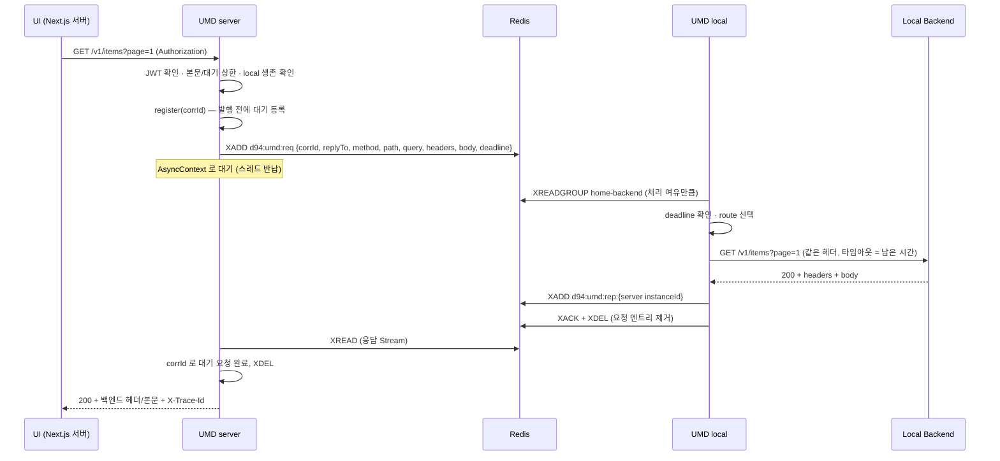

# UMD (UI Mediator) 아키텍처

> 하나의 서비스(`d94-app-umd`)가 **두 모드**로 Redis 양쪽에서 동작하는 **HTTP ↔ Redis Stream 투명 프록시**.
> 방화벽 인바운드를 열지 않고 클라우드 UI 가 Home PC 의 REST 백엔드를 호출할 수 있게 한다.
> 상위 문서: `david94/note/architecture/phase1-architecture.md` · 개발 기록: `note/feature/rest api/`

---

## 1. 한눈에 보기

```
                                      AP-02
 [ Next.js UI ]                    ┌──────────┐
      │ HTTP + JWT                 │  Redis 7 │                         Home PC (인바운드 차단)
      ▼                            │  (AOF)   │
┌─ AP-01 ───────────────┐  XADD    │          │  XREADGROUP   ┌──────────────────────┐   HTTP   ┌──────────────────┐
│ UMD  mode=server      │ ───────▶ │ d94:umd: │ ◀──────────── │ UMD  mode=local      │ ───────▶ │ Local REST       │
│ :8081 API  /**        │          │ req      │  (아웃바운드)  │ 앱 포트 없음         │          │ Backend(s)       │
│ :8091 actuator(내부)  │ ◀─────── │ rep:{id} │ ────────────▶ │ :8091 actuator(내부) │ ◀─────── │ (일반 Spring)    │
└───────────────────────┘  XREAD   │ local:   │  XADD / XACK  └──────────────────────┘          └──────────────────┘
                                   │ alive    │
                                   └──────────┘
```

| 모드 | 위치 | 하는 일 |
|---|---|---|
| `server` | AP-01 | UI 의 모든 요청(`/**`)을 받아 JWT 확인 → HTTP 요청을 Stream 에 적재 → 응답 Stream 을 HTTP 응답으로 복원 |
| `local` | Home PC | Stream 요청을 꺼내 UI 가 부른 것처럼 로컬 백엔드를 REST 호출 → HTTP 응답을 Stream 으로 반환 |
| `both` | 개발·테스트 | 한 프로세스에서 둘 다. 운영 사용 금지 |

같은 jar·이미지를 `UMD_MODE` 로만 구분한다.

---

## 2. 설계 원칙: UMD 는 투명하다

최종 목표는 **백엔드를 서버에 올릴 때 UMD 와 Redis 만 빼면 그대로 동작**하는 것이다.

```
현재:  UI ──REST──▶ UMD(server) ─Redis─ UMD(local) ──REST──▶ Backend
미래:  UI ──REST──────────────────────────────────────────▶ Backend   (UI 의 BACKEND_URL 만 변경)
```

| 원칙 | 구현 |
|---|---|
| 업무를 모른다 | 메서드·경로·쿼리·헤더·본문을 그대로 전달, 상태·헤더·본문을 그대로 반환. 새 API 추가 시 UMD 변경 없음 |
| 경로가 같다 | context-path 없음, local 라우팅도 경로를 바꾸지 않음 |
| 인증은 백엔드가 | `Authorization` 원본 전달. UMD(server) 의 JWT 확인은 Redis 앞 차단용 |
| CORS 는 백엔드가 | UMD 는 OPTIONS(preflight)를 토큰 없이 그대로 전달 |
| 표준 헤더만 | `X-Forwarded-*`, `X-Trace-Id`. 백엔드는 UMD 전용 헤더에 의존하지 않음 |
| 오류는 상태코드로 | UMD 자체 오류도 HTTP 상태(401/413/502/503/504)로. 코드(`X-Umd-Error`)는 진단용 |

---

## 3. 요청 한 건의 흐름



---

## 4. Stream 규격 (`tsh.d94.umd.common.spec`)

UMD 두 모드만 쓰므로 UMD 내부에 둔다. 엔트리는 flat String Map (Redis Insight 에서 그대로 읽힘).

| 키 | 용도 |
|---|---|
| `d94:umd:req` | 요청 Stream. Consumer Group `home-backend`, `MAXLEN ~10000` |
| `d94:umd:rep:{instanceId}` | server 인스턴스별 응답 Stream. `MAXLEN ~1000`, TTL 1시간(10분마다 갱신) |
| `d94:umd:local:alive` | local 생존 신호. 5초마다 `SET EX 15` |

| 요청 필드 (`StreamHttpRequest`) | 응답 필드 (`StreamHttpReply`) |
|---|---|
| `corrId`, `replyTo`, `method`, `path`, `query`, `headers`(JSON), `body`, `bodyEncoding`, `ts`, `deadline` | `corrId`, `status`, `headers`(JSON), `body`, `bodyEncoding`, `ts` |

- `bodyEncoding`: UTF-8 텍스트 계열(`application/json`, `text/*`, `+json`, `+xml` 등)은 `utf8`, 그 외는 `base64` (`StreamBodyCodec`).
- 헤더명은 소문자로 정규화.

---

## 5. 컴포넌트

```
tsh.d94.umd
├── common                       (양 모드)
│   ├── UmdMode / UmdProperties / ConditionalOnUmdMode    모드·설정·모드별 Bean 활성화
│   ├── ProxyHeaderPolicy        헤더 필터 (hop-by-hop, 예약 헤더, X-Forwarded-*)
│   ├── StreamGroupInitializer   Consumer Group 생성 (멱등)
│   ├── UmdSettingsValidator     poll-timeout < Redis 명령 타임아웃 검사
│   ├── error                    UmdErrorCode, UmdErrorResponse (ApiResponse JSON)
│   └── spec                     Stream 규격
├── server                       (server | both)
│   ├── proxy.StreamProxyFilter  /* 서블릿 필터 + AsyncContext
│   ├── proxy.StreamProxyService 사전 차단 → 발행 → 응답 복원 / 오류 매핑
│   ├── StreamRequestGateway, RequestPublisher, PendingReplyRegistry
│   ├── ReplyStreamListener      응답 수신 · XDEL · TTL · 형식 오류 즉시 502
│   ├── LocalAliveChecker        생존 신호 확인 (1초 캐시)
│   ├── security                 JWT 사전 확인, OPTIONS·public-paths 통과
│   └── ServerStreamMetrics, ReplyStreamHealthIndicator, LocalAgentHealthIndicator
└── local                        (local | both)
    ├── RequestStreamConsumer    XREADGROUP 루프 (세마포어로 동시 처리 상한, 가상 스레드)
    ├── LocalRequestProcessor    deadline 확인 → 라우팅 → 호출 → 응답 → XACK+XDEL
    ├── LocalRouteResolver       path-prefix 최장 일치
    ├── LocalHttpDispatcher      JDK HttpClient, 리다이렉트 미추종, 남은 deadline 타임아웃
    ├── ReplyPublisher, PendingReclaimer, LocalHeartbeat
    ├── LocalSecurityConfig      앱 포트 전부 거부 (local 단독)
    └── LocalMetrics, RequestConsumerHealthIndicator
```

**server 를 MVC 컨트롤러가 아닌 서블릿 필터로 만든 이유**: Spring MVC 는 CORS preflight 를 컨트롤러에 넘기지 않고 직접 응답한다. CORS 는 백엔드 소유이므로 preflight 도 전달하려면 MVC 앞에서 받아야 한다. 같은 이유로 PUT/PATCH form 본문을 미리 읽는 `FormContentFilter` 도 끈다.

---

## 6. 헤더 정책 (`ProxyHeaderPolicy`)

| 단계 | 처리 |
|---|---|
| UI → Stream (server) | hop-by-hop(`Connection` 에 나열된 헤더 포함), `Host`, `Content-Length`, `Cookie` 제거. `Authorization` 유지 |
| server 설정 | `X-Forwarded-Proto`·`X-Forwarded-Host`·`X-Trace-Id` 는 덮어쓰기, `X-Forwarded-For` 는 기존 체인 뒤에 직전 홉 추가 |
| Stream → 백엔드 (local) | `Host`·`Content-Length` 는 HTTP 클라이언트가 설정 |
| 백엔드 → Stream → UI | hop-by-hop, `Content-Length` 만 제거. `Location`, `ETag`, `Cache-Control`, `Set-Cookie`, `Access-Control-*` 등 그대로 |

---

## 7. 오류 응답

백엔드 응답은 손대지 않는다. UMD 가 만든 응답만 `ApiResponse` JSON + `X-Umd-Error` (+ `X-Trace-Id`).

| 발생 | 상황 | HTTP | 코드 |
|---|---|---|---|
| server | 토큰 없음/무효 | 401 | `UMD_UNAUTHORIZED` |
| server | 요청 본문 > 1MB | 413 | `UMD_PAYLOAD_TOO_LARGE` |
| server | 대기 요청 ≥ 500 | 503 | `UMD_OVERLOADED` |
| server | local 생존 신호 없음 (즉시) | 503 | `UMD_LOCAL_UNAVAILABLE` |
| server | Redis 장애 | 503 | `UMD_REDIS_UNAVAILABLE` |
| server | 종료 중 | 503 | `UMD_SHUTTING_DOWN` |
| server | 응답 시간 초과 (30s) | 504 | `UMD_TIMEOUT` |
| server | 응답 형식 오류 (즉시) | 502 | `UMD_BAD_REPLY` |
| local | 일치하는 route 없음 | 404 | `UMD_NO_ROUTE` |
| local | 백엔드 연결 실패 | 502 | `UMD_LOCAL_BACKEND_UNAVAILABLE` |
| local | 응답 본문 > 5MB | 502 | `UMD_RESPONSE_TOO_LARGE` |

- 401/413/503 등 Redis 앞에서 거절한 요청은 Stream 에 적재되지 않는다.
- UMD 자체 오류에 한해, 요청 Origin 이 `umd.server.cors-origins` 에 있으면 최소 CORS 헤더를 붙인다 (브라우저가 상태를 읽을 수 있게).

---

## 8. 신뢰성

| 상황 | 동작 |
|---|---|
| local 미기동 | server 가 생존 신호로 감지해 **즉시 503** (30초 대기 없음, Redis 미적재) |
| server 먼저 기동 / local 먼저 기동 | 양쪽 모두 Consumer Group 을 멱등 생성 → 순서 무관 |
| local 처리 중 죽음 | 엔트리가 Pending 에 남음 → `PendingReclaimer` 가 회수(XPENDING+XCLAIM, 60초 이상 대기분) |
| 회수·지연 요청 | local 이 **deadline 을 먼저 확인** → 만료면 백엔드를 부르지 않고 XACK (타임아웃 후 POST 중복 실행 방지) |
| 백엔드가 deadline 넘김 | local 은 응답을 보내지 않음 (server 는 이미 504) |
| 응답 발행 실패 | ACK 하지 않음 → Pending 에 남아 회수 |
| 백엔드 과부하 | local 은 처리 여유(기본 16)만큼만 읽음 |
| 정상 종료 | server: 처리 중 요청 응답 → 리스너 정지 → 남은 대기 503 → 응답 Stream 삭제. local: 읽기 중단 → 처리 중 요청 완료 대기(최대 25s) → 생존 신호 삭제 |
| 비정상 종료 | 응답 Stream TTL 1시간, 생존 신호 TTL 15초로 자동 정리 |
| Redis 장애 | 읽기 실패 시 2초 backoff, 로그는 약 1분 간격, health DOWN (복구 후 10초 내 UP) |
| 민감 데이터 | 요청 엔트리는 처리 직후 XDEL, 응답 엔트리는 수신 직후 XDEL |

---

## 9. 보안

| 항목 | server | local |
|---|---|---|
| 앱 포트 | 8081 공개, JWT 사전 확인 (OPTIONS·`public-paths` 제외) | publish 안 함, 들어와도 전부 거부 |
| actuator (8091) | 내부 전용, 인증 없음 | 내부 전용, 인증 없음 |
| JWT 키 | `JWT_SECRET_KEY` = d94-query 와 동일 | 불필요 |
| Redis | TLS(`REDIS_SSL_ENABLED`) + ACL 사용자(`SPRING_DATA_REDIS_USERNAME`) 권장 | 동일 |
| 최종 인증·인가 | 백엔드가 같은 토큰으로 수행 | |

**한계**: JWT 확인은 무인증 요청을 싸게 거르지만 유효 토큰 사용자의 과다 요청은 막지 못한다. 1차 보호는 대기 요청 상한(503), 필요 시 사용자별 rate limit 추가.

---

## 10. 관측

| 모드 | 지표 (`/actuator/prometheus`) | health |
|---|---|---|
| server | `umd_proxy_request_seconds{method,status,outcome}`, `umd_proxy_rejected_total{reason}`, `umd_stream_pending`, `umd_stream_reply_late_total`, `umd_stream_reply_invalid_total`, `umd_stream_read_errors_total` | `redis`, `replyStream`, `localAgent`(정보용, 항상 UP) |
| local | `umd_local_dispatch_seconds{method,route,status,outcome}`, `umd_local_inflight`, `umd_local_expired_total`, `umd_local_reclaimed_total`, `umd_local_invalid_total`, `umd_local_read_errors_total` | `redis`, `requestConsumer` |

- 경로는 태그로 쓰지 않는다 (값 종류 무한). `status` 는 `2xx` 등 클래스.
- `/actuator/info` 에 모드·instance-id·버전 표시.
- 모든 요청은 `X-Trace-Id`(= corrId) 로 server·local·백엔드 로그를 이어 볼 수 있다.

---

## 11. 주요 설정

| 키 | 기본값 | 설명 |
|---|---|---|
| `umd.mode` | `server` | `server` / `local` / `both` |
| `umd.instance-id` | `HOSTNAME` | server: 응답 Stream 이름 / local: Consumer 이름. 인스턴스마다 고유 |
| `umd.server.request-timeout` | `30s` | 응답 대기 = 요청 deadline |
| `umd.server.max-request-body` | `1MB` | 초과 시 413 |
| `umd.server.max-pending` | `500` | 초과 시 503 |
| `umd.server.require-local-alive` | `true` | 생존 신호 없으면 즉시 503 |
| `umd.server.public-paths` | `[]` | 무토큰 허용 경로 |
| `umd.server.cors-origins` | `[]` | UMD 자체 오류에 붙일 CORS Origin |
| `umd.local.routes` | `[]` | `{id, path-prefix, uri}` 최장 일치 |
| `umd.local.consumer-concurrency` | `16` | 동시 처리 상한 |
| `umd.local.max-response-body` | `5MB` | 초과 시 502 |
| `umd.local.reclaim-idle` / `reclaim-interval` | `60s` / `30s` | Pending 회수 기준 / 주기 |
| `umd.*.poll-timeout` | `2s` | XREAD BLOCK. `spring.data.redis.timeout`(3s)보다 짧아야 함 |

---

## 12. 제약 · 확장

| 항목 | 내용 |
|---|---|
| 지원하지 않음 | SSE·WebSocket·스트리밍 응답, 1MB 넘는 요청 / 5MB 넘는 응답 (파일은 presigned URL 로 우회) |
| 처리 시간 | 30초. 장시간 작업은 백엔드가 202 + 작업 리소스로 설계 |
| 새 API | UMD 변경 없음 (백엔드만 배포) |
| 새 로컬 서비스 | local `routes` 에 한 줄 추가 |
| Phase 2 (다중 server) | `UMD_INSTANCE_ID` 만 서버별로 다르게 (응답 Stream 이 인스턴스별) |
| 직결 전환 | UMD·Redis 제거, `routes` → Ingress/Gateway 규칙, UI `BACKEND_URL` 변경 |
| 개발 가이드 | `note/feature/rest api/ref/ui-development-guide.md`, `backend-development-guide.md` |
